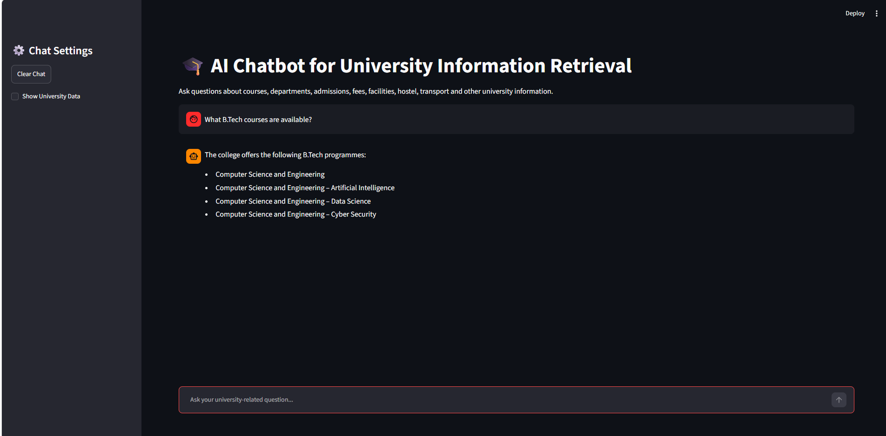

# 🎓 AI Chatbot for University Information Retrieval

## 📌 Project Overview

The **AI Chatbot for University Information Retrieval** is an AI-powered chatbot designed to provide information about a university in a simple and interactive way.

The chatbot uses **Retrieval-Augmented Generation (RAG)** to retrieve relevant information from a university knowledge base and generate answers using a local Large Language Model (LLM).

Users can ask questions related to courses, departments, admissions, fees, facilities, hostel, transport, placements, and other university-related information.

---

## 🖼️ Project Screenshot



---

## 🎯 Objectives

* To develop an AI-based university information chatbot.
* To provide quick and relevant answers to students' questions.
* To use semantic search for retrieving relevant university information.
* To reduce the need for manually searching through university information.
* To use a local LLM for generating answers.

---

## 🛠️ Technologies Used

* **Python** – Programming language
* **Streamlit** – Web application interface
* **Sentence Transformers** – Text embedding and semantic search
* **ChromaDB** – Vector database
* **Ollama** – Local LLM execution
* **Llama 3.2 3B** – Language model
* **HTML/Markdown** – README and interface formatting

---

## 🧠 How the System Works

The chatbot follows these steps:

```text
User Question
      ↓
Sentence Transformer
      ↓
Semantic Search
      ↓
ChromaDB
      ↓
Relevant University Information
      ↓
Ollama + Llama 3.2 3B
      ↓
Generated Answer
      ↓
User
```

---

## 📂 Project Structure

```text
AI_University_Chatbot/
│
├── app.py
├── requirements.txt
├── README.md
├── .gitignore
│
├── data/
│   └── university_info.txt
│
└── assets/
    └── chatbot.png
```

> The `venv/` and `chroma_db/` folders are generated locally and should not be uploaded to GitHub.

---

## ✨ Features

* 🎓 University information retrieval
* 💬 Interactive chatbot interface
* 🔎 Semantic search using Sentence Transformers
* 🗄️ ChromaDB vector database
* 🤖 Local LLM using Ollama
* 📚 University knowledge base
* 🧹 Clear chat option
* 📄 View university information from the sidebar
* 🔒 No external API key required

---

## 📚 Information Covered

The knowledge base contains information related to:

* University details
* Departments
* Courses
* Admissions
* Fees
* Facilities
* Hostel
* Transportation
* Placements
* Examinations
* Student activities
* Technical activities
* Contact information

---

## ⚙️ Installation

### 1. Clone the Repository

```bash
git clone YOUR_GITHUB_REPOSITORY_URL
```

### 2. Open the Project Folder

```bash
cd AI_University_Chatbot
```

### 3. Create a Virtual Environment

```bash
python -m venv venv
```

### 4. Activate the Virtual Environment

For Windows:

```powershell
venv\Scripts\activate
```

### 5. Install Required Packages

```powershell
pip install -r requirements.txt
```

---

## 🤖 Install Ollama Model

Make sure Ollama is installed on your computer.

Then download the required model:

```powershell
ollama pull llama3.2:3b
```

Check the installed model:

```powershell
ollama list
```

---

## ▶️ Run the Application

Start the Streamlit application using:

```powershell
python -m streamlit run app.py
```

The application will open in your browser.

Usually, it will be available at:

```text
http://localhost:8501
```

---

## 💬 Example Questions

You can ask questions such as:

```text
What courses are offered by the university?
```

```text
What departments are available?
```

```text
What facilities are available?
```

```text
Where is the college located?
```

```text
What information is available about hostel facilities?
```

```text
What are the available student activities?
```

---

## 🔄 RAG Workflow

The project uses a simple Retrieval-Augmented Generation workflow.

### 1. Data Collection

University information is stored in:

```text
data/university_info.txt
```

### 2. Text Chunking

The university information is divided into smaller text chunks.

### 3. Embedding Generation

Sentence Transformers converts the text chunks into numerical embeddings.

### 4. Vector Storage

The embeddings are stored in **ChromaDB**.

### 5. Query Processing

When the user asks a question, the question is converted into an embedding.

### 6. Semantic Retrieval

ChromaDB finds the most relevant information from the knowledge base.

### 7. Answer Generation

The retrieved information is given to **Llama 3.2 3B** through Ollama.

### 8. Response

The generated answer is displayed in the Streamlit chatbot interface.

---

## 🔐 Security

This project uses a local Ollama model and does not require an external API key.

The following files/folders should not be uploaded to GitHub:

```text
venv/
.env
__pycache__/
*.pyc
chroma_db/
```

---

## 📋 Requirements

The main Python packages required are:

```text
streamlit
sentence-transformers
chromadb
ollama
torch
```

These packages are listed in `requirements.txt`.

---

## 🚀 Future Enhancements

Possible future improvements include:

* Voice-based interaction
* Multilingual support
* PDF document upload
* Multiple university knowledge bases
* Admin panel for updating information
* Improved conversation memory
* Student admission assistance
* Placement information retrieval
* Mobile-friendly interface

---

## 👨‍💻 Project Type

**AI Full Stack Project**

### Domain

**Artificial Intelligence / Natural Language Processing / Information Retrieval**

### Application

**University Information Retrieval Chatbot**

---

## 📌 Conclusion

The **AI Chatbot for University Information Retrieval** provides an interactive way for students to access university-related information. By combining **Streamlit, Sentence Transformers, ChromaDB, Ollama, and Llama 3.2 3B**, the system can retrieve relevant information from a knowledge base and provide simple AI-generated responses.
